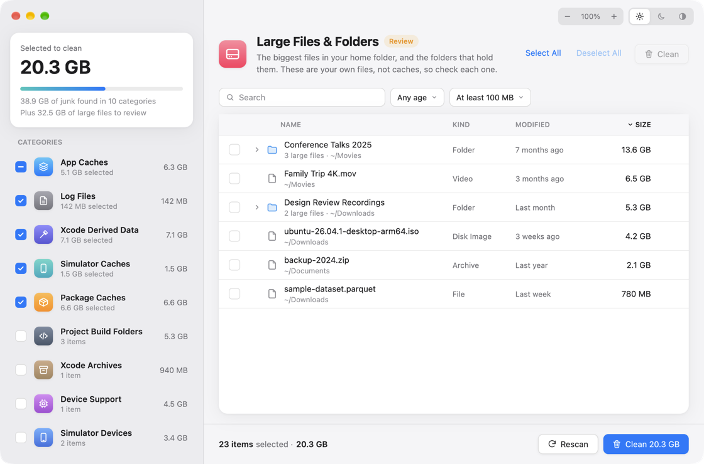
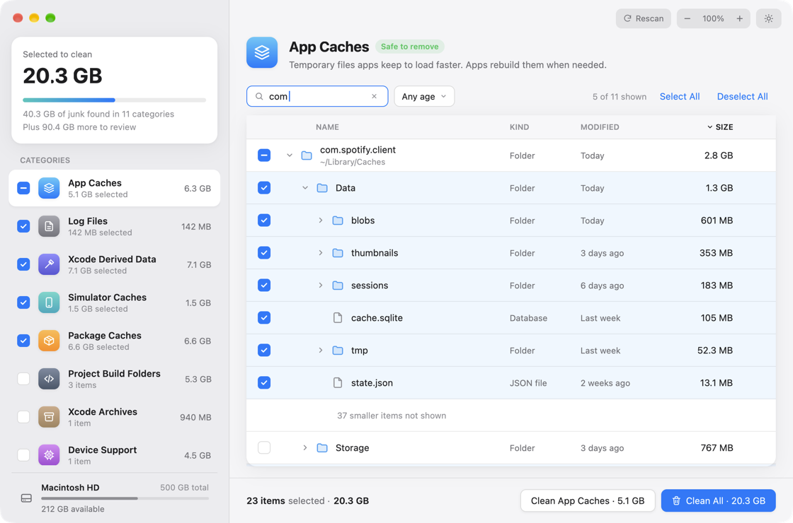

# Mac Cleaner

A native macOS cleaner written in Rust with [GPUI](https://crates.io/crates/gpui), the GPU-drawn UI framework from the Zed editor. It finds caches, logs, developer leftovers and large files, lets you open each folder to see what's inside, and only acts after you confirm every path.

Version 1.2.0. Needs macOS 12 or later. Prebuilt downloads are for Apple Silicon (see [Install](#install)); building from source needs a Rust toolchain.

Created with [Claude Code](https://claude.com/claude-code), Anthropic's AI coding tool. See [Is it safe to run?](#is-it-safe-to-run) for what has been checked.

## Screenshots

These use made-up sample data, not a real Mac. Regenerate them with `./scripts/screenshots.sh`.

**Scan results.** Categories on the left, the items of the open category on the right.


**Dark theme.** The same screen in dark mode; Match System follows the macOS setting.


**Welcome.** What will be scanned, and which categories need a review.


**Scanning.** Progress per category; a scan can be cancelled.


**Open any folder.** See what is inside and tick single items.


**Large Files & Folders.** Your own big files; never pre-selected.



**App Leftovers.** Files left behind by apps you deleted. Anything macOS won't let the app move is marked **Protected by macOS** and left unticked.


**Search and filters.** Type to narrow the list, or filter by age.



**Right-click a row.** Finder, Quick Look, Copy Path and Always Ignore.


**Confirm.** Every path is listed before anything moves to the Trash.


**Result.** Space recovered, and anything that could not be moved.


Every picture is the same window at 100% zoom. The whole interface can also be scaled from 85% to 150%.

## Safety model

- **Nothing is deleted permanently.** Approved items are moved to the Trash (via `NSFileManager`), so you can put them back.
- **Fixed allow-list.** Only the locations below are scanned. Before anything is moved, every path is checked again. It must be an offered item or inside one, with no `..` and no symlinked folder along the way, since a link could point outside the cleanable area. The check runs once more right before each move, so an item that changed in the meantime is left alone.
- **You confirm every item.** Low-risk items are pre-selected. Anything marked **Review**, and Apple's `com.apple.*` caches, start unselected. The confirmation dialog lists the full path of everything that will be moved.

| Category | Location | Default |
|---|---|---|
| App Caches | `~/Library/Caches/*` | selected (except `com.apple.*`) |
| Log Files | `~/Library/Logs/*` | selected |
| Xcode Derived Data | `~/Library/Developer/Xcode/DerivedData/*` | selected |
| Simulator Caches | `~/Library/Developer/CoreSimulator/Caches/*` | selected |
| Package Caches | `~/.npm/_cacache`, `~/.cargo/registry/cache`, `~/.gradle/caches`, `~/Library/pnpm/store`, `~/.bun/install/cache`, `~/.yarn/berry/cache`, `~/go/pkg/mod`, `~/.m2/repository`, `~/.cocoapods/repos` | selected |
| Project Build Folders | `node_modules`, `target`, `.build`, `.next`, `Pods`, Gradle `build`/`.gradle`, `.dart_tool` anywhere in `~`, only when the matching project file (`package.json`, `Cargo.toml`, …) sits next to them | **review** – rebuilding takes time |
| Xcode Archives | `~/Library/Developer/Xcode/Archives/*` | **review** – may hold dSYMs for shipped builds |
| Device Support | `~/Library/Developer/Xcode/{iOS,watchOS} DeviceSupport/*` | **review** |
| Simulator Devices | `~/Library/Developer/CoreSimulator/Devices/*` | **review** – apps and data on the device are lost |
| Installers in Downloads | `~/Downloads/*.{dmg,pkg,mpkg,xip}` | **review** |
| Mail Downloads | `~/Library/Containers/com.apple.mail/Data/Library/Mail Downloads/*` (needs Full Disk Access) | selected |
| iOS Software Updates | `~/Library/iTunes/{iPhone,iPad,iPod} Software Updates/*.ipsw` | selected |
| Device Backups | `~/Library/Application Support/MobileSync/Backup/*` (needs Full Disk Access) | **review** – keep the latest backup of each device |
| Applications | apps in `/Applications` and `~/Applications` (and plain folders one level down) that you can remove without a password, with their files in `~/Library` | **review** |
| App Leftovers | files in `~/Library/{Application Support,Containers,Group Containers,Preferences,Saved Application State,HTTPStorages,WebKit,Cookies,Application Scripts}` named after an app that is no longer installed | **review** |
| Duplicate Files | identical files ≥ 1 MB in `~`, outside the areas Large Files skips; the oldest copy is kept and never listed | **review** |
| Large Files & Folders | files ≥ 100 MB (adjustable: 50 MB to 1 GB) anywhere in `~`, and the folders that hold them | **review**: your own files, never pre-selected |

**Large Files & Folders** offers a large file through its own folder, so a whole download (video, subtitles, extras) can go at once. Open the folder to pick single files instead. Files loose in a top-level folder like `~/Downloads`, and files in code projects (folders with `.git`), are listed on their own; those folders are never offered whole. It skips `~/Library` (app data, iCloud, Mail), hidden folders (`.git`, `.cargo`…), `node_modules`, and macOS packages (`.photoslibrary`, `.app`, `.logicx`, `.fcpbundle`…). Removing one file from inside a package corrupts it. Every file is checked again before it is moved.

**Simulator Devices** are listed by device name and OS version, read from each device's `device.plist`.

**Applications** is the one category outside your home folder. It lists only apps this account can move to the Trash without a password, and never Apple's apps or Mac Cleaner itself. An app is offered whole (its bundle is never opened, so nothing inside it can be removed on its own) and its size includes its support files: entries in `~/Library` named after its bundle identifier, or after its name in Application Support, Caches and Logs. Removing it moves the app and those files to the Trash. An app that is running is left alone.

**App Leftovers** are judged cautiously. Only reverse-DNS names count (`com.vendor.App`, with `group.` and team-ID prefixes removed). Nothing from Apple, nothing from a vendor that still has an app installed or running, and nothing changed in the last 30 days is offered. A leftover that macOS would refuse to move (it is locked, or the app can't write to it or to the folder it sits in) is still listed, so you can see it, but it is marked **Protected by macOS** and starts unticked.

**Duplicate Files** groups files by size, then by a hash of their first 64 KB, then by a hash of their contents. Hard links count once. In each group the oldest file is kept and never listed. Right before a copy is moved it is compared byte by byte with the kept file again; if they differ, or the kept file is gone, the copy is left alone.

**Project Build Folders** uses the same no-go areas as Large Files (`~/Library`, hidden folders, macOS packages). Files inside a build folder are never listed under Large Files as well.

There is no "Empty Trash" button on purpose: a mistaken clean must stay recoverable, so emptying the Trash is left to you in Finder.

## Is it safe to run?

For anyone asking whether this contains a virus: all of the source is in this repository, and you can read it and build the app from it yourself. Below is what the app does, what was checked, and what was not.

**What the app does** (each point can be confirmed in `src/`)

- **Network use is limited to updates.** The app talks to GitHub only, and only to look for and download a new version (see [Updates](#updates)). It sends nothing about your Mac or your files. Turn off "Check for updates automatically" in About Mac Cleaner and it connects only when you choose Check for Updates.
- **Updates are signed.** A downloaded update is installed only if its signature matches the release key built into the app, and the signature names that exact version. Anyone who could change the files on the GitHub release page still couldn't get the app to install something else.
- **No admin rights.** It never asks for a password, and installs no helper, background process or login item.
- **It runs Apple tools, by full path:** `/usr/bin/open` (Finder, the Trash, System Settings), `/usr/bin/qlmanage` (Quick Look) and `/usr/bin/plutil` (to read simulator names and an update's version). For updates it also runs `/usr/bin/curl` (download), `/usr/bin/hdiutil` (open the DMG), `/usr/bin/ditto` (copy the app) and a short `/bin/sh` script that swaps the app once it has quit.
- **It writes its own settings,** and while updating, a staging folder next to them. Everything it removes is moved to the Trash, never deleted.

**Checks run on 2026-11-23**

- **Source review.** Claude read the scanning and cleaning code (about 3,080 lines as it stood that afternoon) looking for ways the app could remove the wrong files. It followed the method in Cloudflare's open-source [security-audit skill](https://github.com/cloudflare/security-audit-skill), in its focused-review mode, not its full six-phase audit. It found no critical or high issues, one medium and one low. Both were fixed the same day, each with a regression test:
  - *Medium:* a scanned folder that was a symlink, or sat below one, could make the app offer and trash files from the link's target. Such folders are now refused.
  - *Low:* a folder on the way to an approved item could be swapped for a link between the check and the move. Every path is now checked again immediately before it is moved.
  - Hardening done at the same time: the home folder is read from the user database, not from `$HOME`; `open` is called by its full path; the snapshot walkthrough exists only in debug builds.
- **Dependency audit.** `cargo audit` 0.23.0 checked all 724 packages in `Cargo.lock` against the RustSec advisory database: **no known vulnerabilities**. It listed 14 "unmaintained" notices, all for packages pulled in by GPUI.

- **Antivirus scan.** The version 1.2.0 release download was uploaded to [VirusTotal](https://www.virustotal.com) on 24 November 2026. VirusTotal runs a file past the engines of many antivirus vendors.
  - the DMG from the [v1.2.0 release](https://github.com/anilcharles/mac-cleaner/releases/tag/v1.2.0): **no engine flagged it**. 0 malicious, 0 suspicious, 61 engines found nothing, 12 do not handle this file type ([report](https://www.virustotal.com/gui/file/cb55cb89ef9c808ab0c507194d60e77a87e77caa5a5170ef89b7d2a478de302d));
  - the program file inside the app: **1 engine flagged it**. Microsoft reported `Trojan:Script/Wacatac.B!ml`; 0 suspicious, 60 engines found nothing, 1 failed, 11 do not handle this file type ([report](https://www.virustotal.com/gui/file/d3f88cd85884daad186faca347b7a507535259711b3a7d0d5e76a82a823b25d8)). The `!ml` ending means Microsoft's machine-learning model guessed from the file's traits, not that it matched known malware. This kind of guess often hits new programs that are not signed with an Apple Developer ID, like this one. It has not been reported to Microsoft as a false positive yet. The source is all in this repository if you want to check for yourself.
  - The earlier 1.0.0 release was not flagged by any engine ([program](https://www.virustotal.com/gui/file/39d98649fdb27db33bda7b1880feb487e2f446df88a4a711aef5f1b1e0f9c8b4), [DMG](https://www.virustotal.com/gui/file/736c031ff62050b6b27649d4e1b9a25e81f91eb1e0fc762f604166c05f5b7a2c)).

**What this does not cover**

- This is not an independent audit or a penetration test. The review was done by Claude, the same AI tool that wrote the code, by reading the source; nobody outside the project has reviewed it.
- A VirusTotal result covers that one build on that day. It is not proof that the app is harmless, and it does not carry over to a later version or to a copy you build yourself, which will have a different fingerprint.
- Cloudflare did not audit, scan, test or endorse this app. The security-audit skill is a published set of review instructions that Claude followed; no Cloudflare service was run.
- Code added after that review has not been reviewed for security: zoom, search and filters, popup menus, the About dialog, the ignore list, Project Build Folders, Simulator Devices, Quick Look and the updater.
- A very small timing window remains between the last check and the move to the Trash, and the home folder itself is not checked for being a symlink.
- The app is ad-hoc signed, not notarized by Apple, so macOS warns when a downloaded copy is opened. A prebuilt copy from someone else cannot be shown to match this source; build it yourself with `./scripts/bundle.sh`.

To repeat the checks: `cargo test` and `cargo install cargo-audit && cargo audit`.

## Working with the results

- **Search and filters.** Type to search the open category (name, location or kind), or press ⌘F. The age menu keeps only items not modified for 30 days, 6 months or a year. In Large Files & Folders, a size menu sets the smallest file listed and scans again. Select All and Deselect All act on what the filter shows.
- **Keyboard.** Any letter starts a search; ↑/↓ move, Space ticks the row, →/← open and close a folder, ⌘1…⌘9 switch category, ⌘A / ⇧⌘A select and deselect, ⌘R scans again, ⌘Y is Quick Look, Return opens the review dialog (it never confirms the move itself), Esc closes or clears. ⌘+ / ⌘− / ⌘0 change the zoom, ⌘W closes the window, ⌘M minimizes it and ⌘Q quits.
- **Columns.** Name, Kind, Modified and Size; click a heading to sort. The Kind column is dropped when the window is too narrow for it.
- **Right-click a row** for Show in Finder, Quick Look, Copy Path, Open Folder and Always Ignore. Ignored items stay out of every later scan until you press Show Again at the bottom of the sidebar.
- **Honest totals.** The sidebar counts junk only; large files are your own files and are listed separately until you select them.
- A scan can be cancelled, and shows how many items it has checked.
- **After a clean,** the result screen shows the space recovered and lists anything that could not be moved, with the reason. If macOS protected an item, a button opens the Full Disk Access settings. When you clean a single category, anything that could not be moved stays in its list marked **Couldn't be moved** and is unticked, so it doesn't look like it is still waiting to go.
- **The welcome screen** shows free disk space, when the last scan ran and how much has been cleaned so far.
- **Storage** for your Mac (name, used-space bar and space available) sits at the bottom of the results sidebar. It is read again every 3 seconds, so emptying the Trash or a big download shows up without a rescan. "Available" matches Finder and System Settings: it includes space macOS frees on demand.

## Menus

| Menu | Items |
|---|---|
| Mac Cleaner | About Mac Cleaner, Check for Updates…, Quit |
| File | Scan Again, Review & Clean…, Quick Look, Close Window |
| Edit | Select All, Deselect All, Find |
| View | Light, Dark, Match System, Zoom In, Zoom Out, Actual Size |
| Window | Minimize |

## Appearance and settings

**Theme.** Click the theme button in the top-right corner (it shows a sun, moon or half circle for the current choice) and pick Light, Dark or Match System, or use the View menu. Match System follows the macOS setting.

**Zoom.** For anyone who finds the interface too small (or too large):

- ⌘+ zooms in, ⌘− zooms out, ⌘0 returns to 100%. The same commands are in the View menu.
- The − 100% + control in the top-right corner does the same with the mouse; clicking the percentage returns to 100%.
- Levels are 85%, 100%, 115%, 130% and 150%.
- Text, icons, spacing, columns, dialogs and popup menus scale together, so the layout looks the same at every level.
- The window grows and shrinks with the zoom and never gets larger than the screen. The smallest size it can be dragged to scales too.
- On a small screen at a high zoom, the welcome, scanning and result screens scroll instead of being cut off.
- The app also follows macOS's own display scaling (System Settings → Displays), like every other app.

How it works: every size in the UI is written as `pt(n)` (defined in `theme.rs`), which stores it in rem units. Changing the zoom changes the window's rem size, and everything follows. New UI code must use `pt()`; real pixels (`gpui::px`) are only for values tied to the mouse or the window, multiplied by the zoom.

**Saved between launches.** The theme, the zoom level, the Large Files size limit, the ignore list, the last scan time, the running total of cleaned space and whether to check for updates automatically are saved as plain text in `~/Library/Application Support/Mac Cleaner/settings.txt`. That folder is never scanned or cleaned.

## Install

**The quick way.** Open **Terminal** (press ⌘Space, type `Terminal`, press Return), paste this and press Return:

```sh
/bin/sh -c 'set -e; cd "$(mktemp -d)"
V=$(curl -fsSL https://api.github.com/repos/anilcharles/mac-cleaner/releases/latest | sed -n "s/.*\"tag_name\": *\"v\([^\"]*\)\".*/\1/p")
DMG="Mac-Cleaner-$V-arm64.dmg"; URL="https://github.com/anilcharles/mac-cleaner/releases/download/v$V"
echo "Downloading Mac Cleaner $V…"
curl -fsSLO "$URL/$DMG"; curl -fsSLO "$URL/$DMG.sha256"; shasum -a 256 -c "$DMG.sha256"
hdiutil attach -nobrowse -quiet -mountpoint mnt "$DMG"
osascript -e "quit app \"Mac Cleaner\"" 2>/dev/null || true
rm -rf "/Applications/Mac Cleaner.app"; ditto "mnt/Mac Cleaner.app" "/Applications/Mac Cleaner.app"
hdiutil detach -quiet mnt; open "/Applications/Mac Cleaner.app"; echo "Mac Cleaner $V is installed."'
```

It downloads the latest release, checks it against its `.sha256`, copies the app into Applications (replacing an older copy) and opens it. Downloaded this way, macOS doesn't show the "Apple could not verify" warning below. It works the same in any shell.

**Or ask an AI assistant.** Paste this into Claude, ChatGPT or another assistant. One that can run commands on your Mac (such as Claude Code) can do the install for you. A chat-only one walks you through it step by step.

```text
Help me install the Mac app "Mac Cleaner" from its GitHub releases:
https://github.com/anilcharles/mac-cleaner/releases/latest

1. Download only from that repository. Get Mac-Cleaner-<version>-arm64.dmg and its .sha256 file from the latest release.
2. Check the download with: shasum -a 256 -c Mac-Cleaner-<version>-arm64.dmg.sha256
   Stop and tell me if the check fails.
3. Quit Mac Cleaner if it is running, then copy "Mac Cleaner.app" from the DMG into /Applications, replacing any older copy.
4. Open the app. If macOS says "Apple could not verify Mac Cleaner is free of malware", don't move it to the Bin.
   Clear the quarantine flag on this one app only: xattr -dr com.apple.quarantine "/Applications/Mac Cleaner.app"
   Never turn off Gatekeeper for the whole Mac.

The app needs a Mac with Apple silicon (M1 or later). If you can run commands on my Mac, do these steps yourself and tell me what you did. If you can't, walk me through them one at a time in Terminal.
```

**Or by hand:**

1. Download `Mac-Cleaner-<version>-arm64.dmg` from the [Releases](https://github.com/anilcharles/mac-cleaner/releases) page. The `.sha256` file next to it lets you check the download: `shasum -a 256 -c Mac-Cleaner-<version>-arm64.dmg.sha256`.
2. Open the DMG and drag **Mac Cleaner** onto the **Applications** shortcut.
3. Open Mac Cleaner from Applications.

What changed in each version is listed in the notes of each [release](https://github.com/anilcharles/mac-cleaner/releases).

### Updates

From version 1.3.0, Mac Cleaner keeps itself up to date. (Versions 1.2.0 and earlier have to be updated by hand, once.)

- A few seconds after launch, and once a day while it stays open, the app asks GitHub for the latest release. When there is a newer one, an **Update Available** button appears in the top-right corner. Nothing is downloaded until you click it.
- The button opens a dialog with the release notes. **Update Now** downloads the DMG with a progress bar, checks its signature, quits, swaps the app in Applications and opens the new version. **Later** closes the dialog; the button stays.
- **Check for Updates…** in the Mac Cleaner menu, or the button in About Mac Cleaner, checks right away. About Mac Cleaner also has the **Check for updates automatically** switch.
- If anything goes wrong (no connection, a bad signature, an app folder it can't write to), the dialog says so and the installed app is left as it was.

How releases are signed: CI signs each DMG with [minisign](https://jedisct1.github.io/minisign/) and uploads the signature as `Mac-Cleaner-<version>-arm64.dmg.minisig`. Its trusted comment is the DMG's file name, so a signature from an older release can't be passed off as a newer one. The public key is in `src/updater.rs`; the secret key is the `MINISIGN_SECRET_KEY` repository secret. To check a download by hand: `minisign -Vm Mac-Cleaner-<version>-arm64.dmg -P RWQY3Ut882lI3/1xnXKTU/0Z74Iv8BV6izJOrYJ9F2irRv6MCb0xT5k4`.

**"Apple could not verify Mac Cleaner is free of malware".** The first time you open a copy downloaded in a web browser, macOS shows this warning. The app is ad-hoc signed but not notarized by Apple, and macOS checks for notarization on anything a browser downloads. Do not click **Move to Bin**; click **Done**, then either:

- open **System Settings → Privacy & Security**, scroll to *"Mac Cleaner" was blocked*, and click **Open Anyway**; or
- run `xattr -dr com.apple.quarantine "/Applications/Mac Cleaner.app"` in Terminal, then open the app again.

You only need to do this once per downloaded copy. Copies built locally (`./scripts/install.sh`) or downloaded with `gh release download` are not marked by the browser and open without the warning. If you already clicked Move to Bin, drag **Mac Cleaner** from the Bin back to Applications and use one of the steps above.

The warning will go away for good once releases are signed with an Apple Developer ID and notarized.

## Run

```sh
cargo run --release
```

## Build the app

```sh
./scripts/bundle.sh        # → target/release/Mac Cleaner.app (ad-hoc signed)
./scripts/install.sh       # build, quit the running app, replace /Applications/Mac Cleaner.app, open it
./scripts/screenshots.sh   # regenerate docs/screenshots/ from sample data
```

**Releasing** is automated with [release-please](https://github.com/googleapis/release-please). Pull requests are squash-merged and their titles follow [Conventional Commits](https://www.conventionalcommits.org/): `feat:` for a new feature, `fix:` for a bug fix, and `docs:`, `ci:`, `chore:`, `refactor:` or `test:` for everything else (a CI check enforces this). After `feat:` or `fix:` changes are merged, release-please opens a `chore: release x.y.z` pull request that bumps the version and lists those changes as the release notes. Merging it tags `vx.y.z`, publishes the GitHub Release with those notes, and the self-hosted runner builds the DMG and attaches it.

## Tests

```sh
cargo test                                              # allow-list, symlink, large-file, build-folder, filter, selection and settings tests
cargo test real_scan_summary -- --ignored --nocapture   # read-only scan of your Mac
```

## UI snapshots (development)

The app can capture its own window, which needs no Screen Recording permission. This walks through every screen, saves PNGs, and quits. It **never cleans anything** and never changes the saved settings; the result screen uses a made-up report.

```sh
MAC_CLEANER_SNAPSHOT_DIR=/tmp/shots MAC_CLEANER_THEME=dark MAC_CLEANER_ZOOM=1.3 cargo run   # debug builds only; release builds ignore this variable
```

`MAC_CLEANER_THEME` (`light` or `dark`) and `MAC_CLEANER_ZOOM` (0.5 to 3.0) override the saved choices for that run. The walkthrough covers the welcome screen (also at the smallest window size), scanning, results, an opened folder, Large Files & Folders, search, the right-click menu, About, the confirm dialog, the smallest window size, a zoom step in and back, and the result screen. The screenshots show real file names from your Mac, so check them before sharing. The walkthrough keeps its window in front of other apps, since a covered window is not redrawn and frames would repeat.

**Sample data.** Add `MAC_CLEANER_SAMPLE=1` to skip the scan and show made-up results from `src/sample.rs` instead (paths under `/Users/you`, invented sizes, a fixed disk size). `./scripts/screenshots.sh` uses this to regenerate `docs/screenshots/` for this README in light and dark.

## How it is checked

- **Unit tests** cover the allow-list, symlink handling, the large-file and build-folder rules, app-leftover matching, duplicate detection, tree selection, filters and saved settings. They use temporary folders, never real files.
- **Layout** is checked from the snapshots above, at 85%, 100% and 150% zoom, in light and dark, including the smallest window size.
- **Not covered automatically:** pressing keyboard shortcuts, clicking menu items and dragging the window by its top edge. Try these by hand after changing that code.
- **Moving files to the Trash** is only ever done by a person using the app. No test or walkthrough cleans anything.

## Project layout

```
src/
  main.rs       app start-up, window, menu, embedded icons, progress-ring SVG
  ui.rs         GPUI view: all screens, table, dialog, building blocks
  app.rs        state and tree-selection logic (UI-independent, unit tested)
  scanner.rs    scanning, allow-list, folder listing, move-to-Trash
  apps.rs       installed apps, their support files, leftovers of deleted apps
  duplicates.rs identical-file search and the byte-by-byte recheck before a move
  theme.rs      light/dark palette, layout metrics, zoom levels and the pt() size unit
  settings.rs   saved choices: theme, zoom, size limit, ignore list, history, update checks
  updater.rs    update check, download, signature check and the swap into Applications
  native.rs     AppKit calls GPUI does not expose (minimum window size, usable screen size)
  snapshot.rs   developer-only self-capture for UI checks (debug builds)
  sample.rs     made-up scan results for README screenshots (debug builds)
assets/icons/   SVG line icons used in the UI
assets/icon/    app icon source: make_icon.py → AppIcon.svg → render_icon.sh → AppIcon.icns
```

## Notes

- GPUI is pre-1.0; this project pins `gpui = "0.2.2"`.
- Some `com.apple.*` caches are protected by macOS. Cleaning them fails with a clear message unless the app has Full Disk Access.
- Space is only freed once you empty the Trash.
