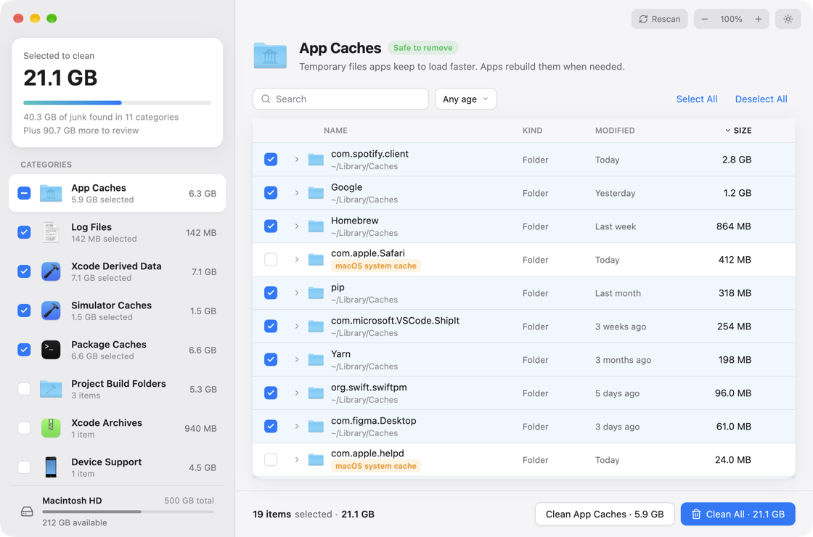
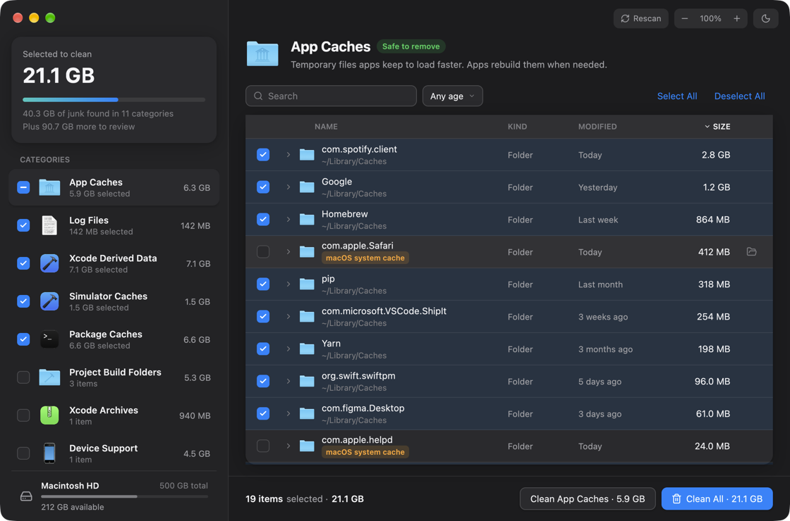
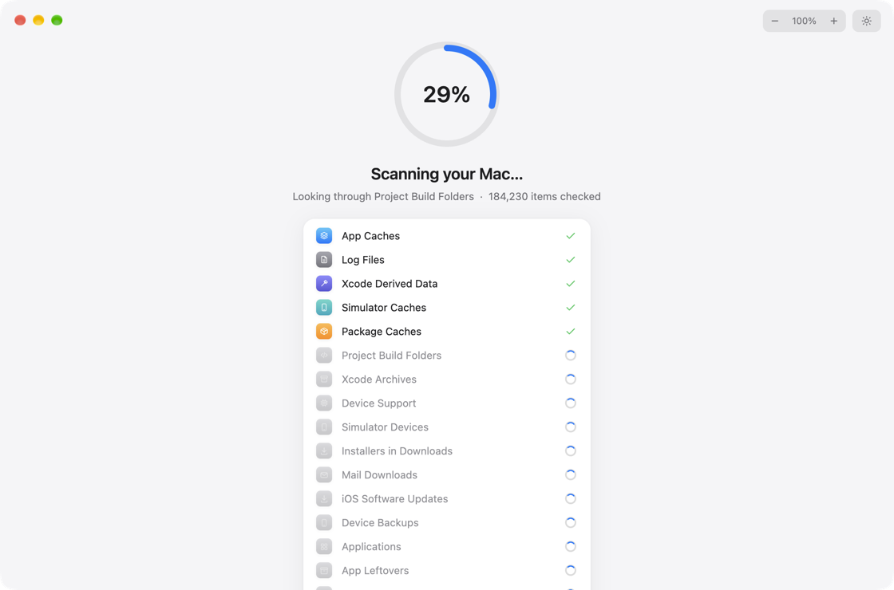
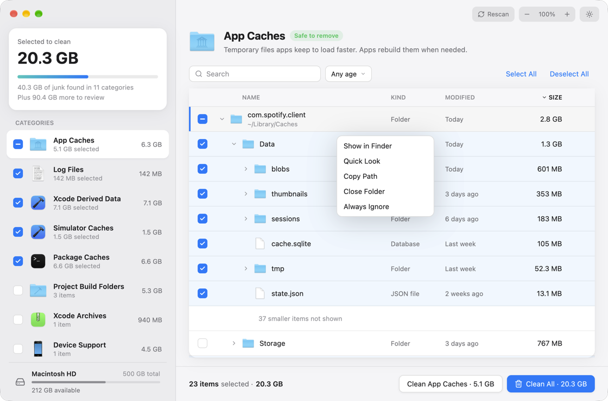
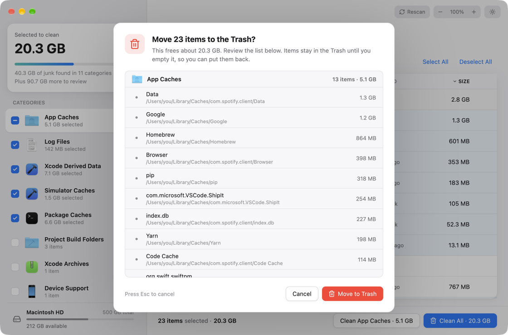
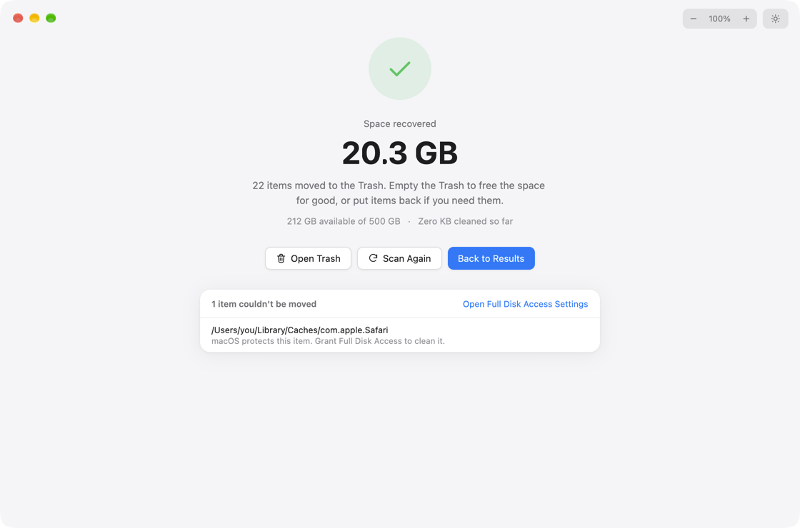

# Mac Cleaner

A native macOS cleaner written in Rust with [GPUI](https://crates.io/crates/gpui), the GPU-drawn UI framework from the Zed editor. It finds caches, logs, developer leftovers and large files, lets you open each folder to see what's inside, and only acts after you confirm every path.

Version 1.0.0. Needs macOS 12 or later. Prebuilt downloads are for Apple Silicon (see [Install](#install)); building from source needs a Rust toolchain.

Created with [Claude Code](https://claude.com/claude-code), Anthropic's AI coding tool. See [Is it safe to run?](#is-it-safe-to-run) for what has been checked.

## Screenshots

These use made-up sample data, not a real Mac. Regenerate them with `./scripts/screenshots.sh`.

| Light | Dark |
|---|---|
|  |  |

**Scan results.** Categories on the left, the items of the open category on the right.

| | |
|---|---|
|  |  |
| **Welcome.** What will be scanned, and which categories need a review. | **Scanning.** Progress per category; a scan can be cancelled. |
|  |  |
| **Open any folder.** See what is inside and tick single items. | **Large Files & Folders.** Your own big files; never pre-selected. |
|  |  |
| **Search and filters.** Type to narrow the list, or filter by age. | **Right-click a row.** Finder, Quick Look, Copy Path and Always Ignore. |
|  |  |
| **Confirm.** Every path is listed before anything moves to the Trash. | **Result.** Space recovered, and anything that could not be moved. |

Every picture is the same window at 100% zoom. The whole interface can also be scaled from 85% to 150%.

## Safety model

- **Nothing is deleted permanently.** Approved items are moved to the Trash (via `NSFileManager`), so you can put them back.
- **Fixed allow-list.** Only the locations below are scanned. Before anything is moved, every path is checked again. It must be an offered item or inside one, with no `..` and no symlinked folder along the way, since a link could point outside the cleanable area. The check runs once more right before each move, so an item that changed in the meantime is left alone.
- **You confirm every item.** Low-risk items are pre-selected. Anything marked **Review**, and Apple's `com.apple.*` caches, start unselected. The confirmation dialog lists the full path of everything that will be moved.

| Category | Location | Default |
|---|---|---|
| App Caches | `~/Library/Caches/*` | selected (except `com.apple.*`) |
| Log Files | `~/Library/Logs/*` | selected |
| Xcode Derived Data | `~/Library/Developer/Xcode/DerivedData/*` | selected |
| Simulator Caches | `~/Library/Developer/CoreSimulator/Caches/*` | selected |
| Package Caches | `~/.npm/_cacache`, `~/.cargo/registry/cache`, `~/.gradle/caches`, `~/Library/pnpm/store`, `~/.bun/install/cache`, `~/.yarn/berry/cache`, `~/go/pkg/mod`, `~/.m2/repository`, `~/.cocoapods/repos` | selected |
| Project Build Folders | `node_modules`, `target`, `.build`, `.next`, `Pods`, Gradle `build`/`.gradle`, `.dart_tool` anywhere in `~`, only when the matching project file (`package.json`, `Cargo.toml`, …) sits next to them | **review** – rebuilding takes time |
| Xcode Archives | `~/Library/Developer/Xcode/Archives/*` | **review** – may hold dSYMs for shipped builds |
| Device Support | `~/Library/Developer/Xcode/{iOS,watchOS} DeviceSupport/*` | **review** |
| Simulator Devices | `~/Library/Developer/CoreSimulator/Devices/*` | **review** – apps and data on the device are lost |
| Installers in Downloads | `~/Downloads/*.{dmg,pkg,mpkg,xip}` | **review** |
| Large Files & Folders | files ≥ 100 MB (adjustable: 50 MB to 1 GB) anywhere in `~`, and the folders that hold them | **review**: your own files, never pre-selected |

**Large Files & Folders** offers a large file through its own folder, so a whole download (video, subtitles, extras) can go at once. Open the folder to pick single files instead. Files loose in a top-level folder like `~/Downloads`, and files in code projects (folders with `.git`), are listed on their own; those folders are never offered whole. It skips `~/Library` (app data, iCloud, Mail), hidden folders (`.git`, `.cargo`…), `node_modules`, and macOS packages (`.photoslibrary`, `.app`, `.logicx`, `.fcpbundle`…). Removing one file from inside a package corrupts it. Every file is checked again before it is moved.

**Simulator Devices** are listed by device name and OS version, read from each device's `device.plist`.

**Project Build Folders** uses the same no-go areas as Large Files (`~/Library`, hidden folders, macOS packages). Files inside a build folder are never listed under Large Files as well.

There is no "Empty Trash" button on purpose: a mistaken clean must stay recoverable, so emptying the Trash is left to you in Finder.

## Is it safe to run?

For anyone asking whether this contains a virus: all of the source is in this repository, and you can read it and build the app from it yourself. Below is what the app does, what was checked, and what was not.

**What the app does** (each point can be confirmed in `src/`)

- **No network use.** The app's own code has no networking, and it sends nothing anywhere. Its UI framework (GPUI) includes an HTTP client that the app never calls. The running app held no network connections when checked on 2026-11-23.
- **No admin rights.** It never asks for a password, and installs no helper, background process or login item.
- **It runs three Apple tools, by full path:** `/usr/bin/open` (Finder, the Trash, System Settings), `/usr/bin/qlmanage` (Quick Look) and `/usr/bin/plutil` (to read simulator names).
- **It writes one file:** its own settings. Everything it removes is moved to the Trash, never deleted.

**Checks run on 2026-11-23**

- **Source review.** Claude read the scanning and cleaning code (about 3,080 lines as it stood that afternoon) looking for ways the app could remove the wrong files. It followed the method in Cloudflare's open-source [security-audit skill](https://github.com/cloudflare/security-audit-skill), in its focused-review mode, not its full six-phase audit. It found no critical or high issues, one medium and one low. Both were fixed the same day, each with a regression test:
  - *Medium:* a scanned folder that was a symlink, or sat below one, could make the app offer and trash files from the link's target. Such folders are now refused.
  - *Low:* a folder on the way to an approved item could be swapped for a link between the check and the move. Every path is now checked again immediately before it is moved.
  - Hardening done at the same time: the home folder is read from the user database, not from `$HOME`; `open` is called by its full path; the snapshot walkthrough exists only in debug builds.
- **Dependency audit.** `cargo audit` 0.23.0 checked all 724 packages in `Cargo.lock` against the RustSec advisory database: **no known vulnerabilities**. It listed 14 "unmaintained" notices, all for packages pulled in by GPUI.

- **Antivirus scan.** A build of version 0.3.0 made from this source was uploaded to [VirusTotal](https://www.virustotal.com), which runs a file past the engines of many antivirus vendors. **No engine flagged it:**
  - the program file: 0 malicious, 0 suspicious, 62 engines found nothing, 11 do not handle this file type ([report](https://www.virustotal.com/gui/file/bbe51fb73dcba522a90fccae6635a669c281227d9522f90f264baa04846fef63));
  - the zipped app: 0 malicious, 0 suspicious, 56 engines found nothing, 8 timed out or failed, 9 do not handle this file type ([report](https://www.virustotal.com/gui/file/5e05cfb3a6c0bf8587c3ab3a973bea78f69e658e7ad6118423aeff81fd798715)).

**What this does not cover**

- This is not an independent audit or a penetration test. The review was done by Claude, the same AI tool that wrote the code, by reading the source; nobody outside the project has reviewed it.
- The VirusTotal result means no engine recognised known malware in that one build on that day. It is not proof that the app is harmless, and it does not carry over to a later version or to a copy you build yourself, which will have a different fingerprint.
- Cloudflare did not audit, scan, test or endorse this app. The security-audit skill is a published set of review instructions that Claude followed; no Cloudflare service was run.
- Code added after that review has not been reviewed for security: zoom, search and filters, popup menus, the About dialog, the ignore list, Project Build Folders, Simulator Devices and Quick Look.
- A very small timing window remains between the last check and the move to the Trash, and the home folder itself is not checked for being a symlink.
- The app is ad-hoc signed, not notarized by Apple, so macOS warns when a downloaded copy is opened. A prebuilt copy from someone else cannot be shown to match this source; build it yourself with `./scripts/bundle.sh`.

To repeat the checks: `cargo test` and `cargo install cargo-audit && cargo audit`.

## Working with the results

- **Search and filters.** Type to search the open category (name, location or kind), or press ⌘F. The age menu keeps only items not modified for 30 days, 6 months or a year. In Large Files & Folders, a size menu sets the smallest file listed and scans again. Select All and Deselect All act on what the filter shows.
- **Keyboard.** Any letter starts a search; ↑/↓ move, Space ticks the row, →/← open and close a folder, ⌘1…⌘9 switch category, ⌘A / ⇧⌘A select and deselect, ⌘R scans again, ⌘Y is Quick Look, Return opens the review dialog (it never confirms the move itself), Esc closes or clears. ⌘+ / ⌘− / ⌘0 change the zoom, ⌘W closes the window, ⌘M minimizes it and ⌘Q quits.
- **Columns.** Name, Kind, Modified and Size; click a heading to sort. The Kind column is dropped when the window is too narrow for it.
- **Right-click a row** for Show in Finder, Quick Look, Copy Path, Open Folder and Always Ignore. Ignored items stay out of every later scan until you press Show Again at the bottom of the sidebar.
- **Honest totals.** The sidebar counts junk only; large files are your own files and are listed separately until you select them.
- A scan can be cancelled, and shows how many items it has checked.
- **After a clean,** the result screen shows the space recovered and lists anything that could not be moved, with the reason. If macOS protected an item, a button opens the Full Disk Access settings.
- **The welcome screen** shows free disk space, when the last scan ran and how much has been cleaned so far.

## Menus

| Menu | Items |
|---|---|
| Mac Cleaner | About Mac Cleaner, Quit |
| File | Scan Again, Review & Clean…, Quick Look, Close Window |
| Edit | Select All, Deselect All, Find |
| View | Light, Dark, Match System, Zoom In, Zoom Out, Actual Size |
| Window | Minimize |

## Appearance and settings

**Theme.** Use the Light / Dark / Auto switch in the top-right corner or the View menu. Auto follows the macOS setting.

**Zoom.** For anyone who finds the interface too small (or too large):

- ⌘+ zooms in, ⌘− zooms out, ⌘0 returns to 100%. The same commands are in the View menu.
- The − 100% + control in the top-right corner does the same with the mouse; clicking the percentage returns to 100%.
- Levels are 85%, 100%, 115%, 130% and 150%.
- Text, icons, spacing, columns, dialogs and popup menus scale together, so the layout looks the same at every level.
- The window grows and shrinks with the zoom and never gets larger than the screen. The smallest size it can be dragged to scales too.
- On a small screen at a high zoom, the welcome, scanning and result screens scroll instead of being cut off.
- The app also follows macOS's own display scaling (System Settings → Displays), like every other app.

How it works: every size in the UI is written as `pt(n)` (defined in `theme.rs`), which stores it in rem units. Changing the zoom changes the window's rem size, and everything follows. New UI code must use `pt()`; real pixels (`gpui::px`) are only for values tied to the mouse or the window, multiplied by the zoom.

**Saved between launches.** The theme, the zoom level, the Large Files size limit, the ignore list, the last scan time and the running total of cleaned space are saved as plain text in `~/Library/Application Support/Mac Cleaner/settings.txt`. That folder is never scanned or cleaned.

## Install

1. Download `Mac-Cleaner-<version>-arm64.dmg` from the [Releases](https://github.com/anilcharles/mac-cleaner/releases) page. The `.sha256` file next to it lets you check the download: `shasum -a 256 -c Mac-Cleaner-<version>-arm64.dmg.sha256`.
2. Open the DMG and drag **Mac Cleaner** onto the **Applications** shortcut.
3. Open Mac Cleaner from Applications.

**"Apple could not verify Mac Cleaner is free of malware".** The first time you open a copy downloaded in a web browser, macOS shows this warning. The app is ad-hoc signed but not notarized by Apple, and macOS checks for notarization on anything a browser downloads. Do not click **Move to Bin**; click **Done**, then either:

- open **System Settings → Privacy & Security**, scroll to *"Mac Cleaner" was blocked*, and click **Open Anyway**; or
- run `xattr -dr com.apple.quarantine "/Applications/Mac Cleaner.app"` in Terminal, then open the app again.

You only need to do this once per downloaded copy. Copies built locally (`./scripts/install.sh`) or downloaded with `gh release download` are not marked by the browser and open without the warning. If you already clicked Move to Bin, drag **Mac Cleaner** from the Bin back to Applications and use one of the steps above.

The warning will go away for good once releases are signed with an Apple Developer ID and notarized.

## Run

```sh
cargo run --release
```

## Build the app

```sh
./scripts/bundle.sh        # → target/release/Mac Cleaner.app (ad-hoc signed)
./scripts/install.sh       # build, quit the running app, replace /Applications/Mac Cleaner.app, open it
./scripts/screenshots.sh   # regenerate docs/screenshots/ from sample data
```

## Tests

```sh
cargo test                                              # allow-list, symlink, large-file, build-folder, filter, selection and settings tests
cargo test real_scan_summary -- --ignored --nocapture   # read-only scan of your Mac
```

## UI snapshots (development)

The app can capture its own window, which needs no Screen Recording permission. This walks through every screen, saves PNGs, and quits. It **never cleans anything** and never changes the saved settings; the result screen uses a made-up report.

```sh
MAC_CLEANER_SNAPSHOT_DIR=/tmp/shots MAC_CLEANER_THEME=dark MAC_CLEANER_ZOOM=1.3 cargo run   # debug builds only; release builds ignore this variable
```

`MAC_CLEANER_THEME` (`light` or `dark`) and `MAC_CLEANER_ZOOM` (0.5 to 3.0) override the saved choices for that run. The walkthrough covers the welcome screen (also at the smallest window size), scanning, results, an opened folder, Large Files & Folders, search, the right-click menu, About, the confirm dialog, the smallest window size, a zoom step in and back, and the result screen. The screenshots show real file names from your Mac, so check them before sharing. The walkthrough keeps its window in front of other apps, since a covered window is not redrawn and frames would repeat.

**Sample data.** Add `MAC_CLEANER_SAMPLE=1` to skip the scan and show made-up results from `src/sample.rs` instead (paths under `/Users/you`, invented sizes, a fixed disk size). `./scripts/screenshots.sh` uses this to regenerate `docs/screenshots/` for this README in light and dark.

## How it is checked

- **Unit tests** cover the allow-list, symlink handling, the large-file and build-folder rules, tree selection, filters and saved settings. They use temporary folders, never real files.
- **Layout** is checked from the snapshots above, at 85%, 100% and 150% zoom, in light and dark, including the smallest window size.
- **Not covered automatically:** pressing keyboard shortcuts, clicking menu items and dragging the window by its top edge. Try these by hand after changing that code.
- **Moving files to the Trash** is only ever done by a person using the app. No test or walkthrough cleans anything.

## Project layout

```
src/
  main.rs       app start-up, window, menu, embedded icons, progress-ring SVG
  ui.rs         GPUI view: all screens, table, dialog, building blocks
  app.rs        state and tree-selection logic (UI-independent, unit tested)
  scanner.rs    scanning, allow-list, folder listing, move-to-Trash
  theme.rs      light/dark palette, layout metrics, zoom levels and the pt() size unit
  settings.rs   saved choices: theme, zoom, size limit, ignore list, history
  native.rs     AppKit calls GPUI does not expose (minimum window size, usable screen size)
  snapshot.rs   developer-only self-capture for UI checks (debug builds)
  sample.rs     made-up scan results for README screenshots (debug builds)
assets/icons/   SVG line icons used in the UI
assets/icon/    app icon source: make_icon.py → AppIcon.svg (rendered into AppIcon.icns)
```

## Notes

- GPUI is pre-1.0; this project pins `gpui = "0.2.2"`.
- Some `com.apple.*` caches are protected by macOS. Cleaning them fails with a clear message unless the app has Full Disk Access.
- Space is only freed once you empty the Trash.
