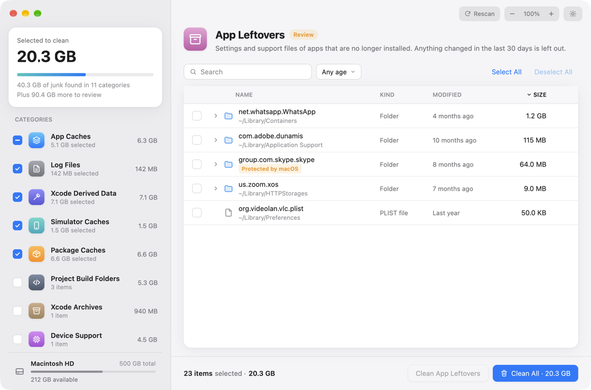

# Mac Cleaner

A native macOS cleaner written in Rust with [GPUI](https://crates.io/crates/gpui), the GPU-drawn UI framework from the Zed editor. It finds caches, logs, developer leftovers, large files, duplicates and the files deleted apps leave behind. You can open each folder to see what's inside, and nothing is moved until you confirm every path.

Version 1.2.0. Needs macOS 12 or later. Prebuilt downloads are for Apple Silicon. Created with [Claude Code](https://claude.com/claude-code), Anthropic's AI coding tool.




More screenshots, keyboard shortcuts, menus and settings are in **[Using Mac Cleaner](docs/using.md)**.

## Install

**The quick way.** Open **Terminal** (press ⌘Space, type `Terminal`, press Return), paste this and press Return:

```sh
/bin/sh -c 'set -e; cd "$(mktemp -d)"
V=$(curl -fsSL https://api.github.com/repos/anilcharles/mac-cleaner/releases/latest | sed -n "s/.*\"tag_name\": *\"v\([^\"]*\)\".*/\1/p")
DMG="Mac-Cleaner-$V-arm64.dmg"; URL="https://github.com/anilcharles/mac-cleaner/releases/download/v$V"
echo "Downloading Mac Cleaner $V…"
curl -fsSLO "$URL/$DMG"; curl -fsSLO "$URL/$DMG.sha256"; shasum -a 256 -c "$DMG.sha256"
hdiutil attach -nobrowse -quiet -mountpoint mnt "$DMG"
osascript -e "quit app \"Mac Cleaner\"" 2>/dev/null || true
rm -rf "/Applications/Mac Cleaner.app"; ditto "mnt/Mac Cleaner.app" "/Applications/Mac Cleaner.app"
hdiutil detach -quiet mnt; open "/Applications/Mac Cleaner.app"; echo "Mac Cleaner $V is installed."'
```

It downloads the latest release, checks it against its `.sha256`, copies the app into Applications (replacing an older copy) and opens it. Downloaded this way, macOS doesn't show the "Apple could not verify" warning below. It works the same in any shell.

**Or ask an AI assistant.** Paste this into Claude, ChatGPT or another assistant. One that can run commands on your Mac (such as Claude Code) can do the install for you. A chat-only one walks you through it step by step.

```text
Help me install the Mac app "Mac Cleaner" from its GitHub releases:
https://github.com/anilcharles/mac-cleaner/releases/latest

1. Download only from that repository. Get Mac-Cleaner-<version>-arm64.dmg and its .sha256 file from the latest release.
2. Check the download with: shasum -a 256 -c Mac-Cleaner-<version>-arm64.dmg.sha256
   Stop and tell me if the check fails.
3. Quit Mac Cleaner if it is running, then copy "Mac Cleaner.app" from the DMG into /Applications, replacing any older copy.
4. Open the app. If macOS says "Apple could not verify Mac Cleaner is free of malware", don't move it to the Bin.
   Clear the quarantine flag on this one app only: xattr -dr com.apple.quarantine "/Applications/Mac Cleaner.app"
   Never turn off Gatekeeper for the whole Mac.

The app needs a Mac with Apple silicon (M1 or later). If you can run commands on my Mac, do these steps yourself and tell me what you did. If you can't, walk me through them one at a time in Terminal.
```

**Or by hand:**

1. Download `Mac-Cleaner-<version>-arm64.dmg` from [Releases](https://github.com/anilcharles/mac-cleaner/releases). The release notes there list what changed.
2. Open the DMG and drag **Mac Cleaner** onto **Applications**.
3. Open Mac Cleaner from Applications.

**"Apple could not verify Mac Cleaner is free of malware".** macOS shows this the first time you open a copy downloaded in a browser, because the app is not notarized by Apple. Don't click **Move to Bin**. Click **Done**, then either:

- open **System Settings → Privacy & Security** and click **Open Anyway** next to *"Mac Cleaner" was blocked*, or
- run `xattr -dr com.apple.quarantine "/Applications/Mac Cleaner.app"` in Terminal and open the app again.

You only need to do this once per download.

**Updates.** From version 1.3.0 the app updates itself: when a new release is out, an **Update Available** button appears in the top-right corner, and one click installs it. See [Updates](docs/using.md#updates).

## What it cleans

App caches, log files, Xcode derived data, archives and device support, simulator caches and devices, package-manager caches, project build folders, installers in Downloads, Mail downloads, iOS updates and backups, apps with their support files, app leftovers, duplicate files, and large files and folders.

Low-risk items are pre-selected. Anything that needs a closer look is marked **Review** and starts unticked. The full list of locations is in the [Safety model](docs/safety.md).

## Safety

- **Nothing is deleted permanently.** Everything goes to the Trash, so you can put it back. Space is freed once you empty the Trash.
- **Fixed list of locations.** Only known folders are scanned, and every path is checked again right before it is moved.
- **You confirm every item.** The confirmation dialog lists the full path of everything that will move.
- **Network only for updates, no admin rights.** The app talks to GitHub only to look for and download new versions, sends nothing about your Mac or your files, and installs an update only if it carries the project's signature. It never asks for a password.

What was checked, including the [VirusTotal](https://www.virustotal.com) results for each release, is in **[Is it safe to run?](docs/security.md)**. In short, the 1.2.0 DMG is [clean](https://www.virustotal.com/gui/file/cb55cb89ef9c808ab0c507194d60e77a87e77caa5a5170ef89b7d2a478de302d), and the program inside it got [one machine-learning detection from Microsoft](https://www.virustotal.com/gui/file/d3f88cd85884daad186faca347b7a507535259711b3a7d0d5e76a82a823b25d8), which that page explains.

## Build from source

```sh
cargo run --release        # run it
./scripts/install.sh       # build and install to /Applications
cargo test                 # run the tests
```

Building, releasing, tests and the project layout are in **[Development](docs/development.md)**.
