# Using Mac Cleaner

[← Back to the README](../README.md)

## Screenshots

These use made-up sample data, not a real Mac. Regenerate them with `./scripts/screenshots.sh` (see [Development](development.md#ui-snapshots)).

**Scan results.** Categories on the left, the items of the open category on the right.

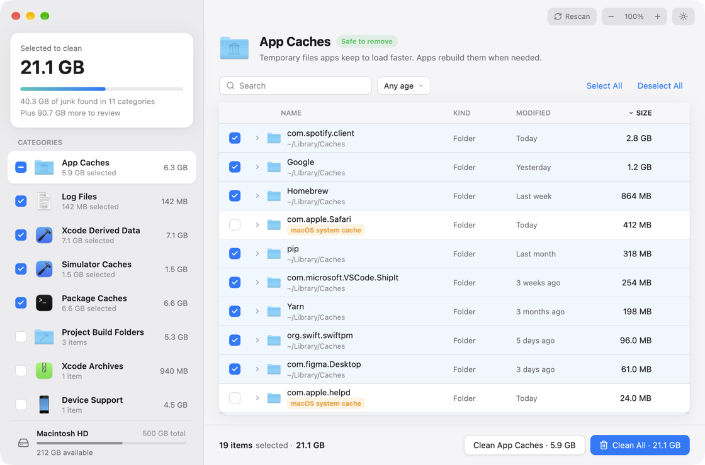

**Dark theme.** The same screen in dark mode; Match System follows the macOS setting.

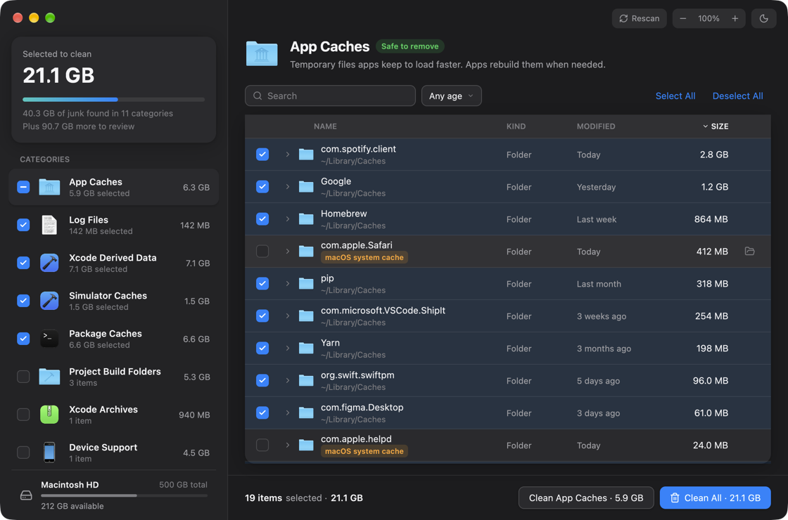

**Welcome.** What will be scanned, and which categories need a review.

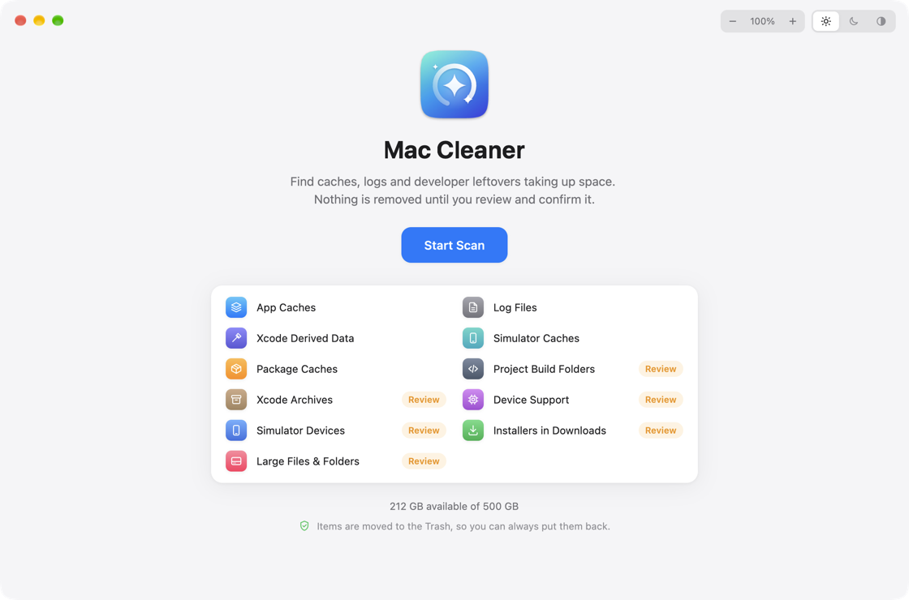

**Scanning.** Progress per category; a scan can be cancelled.

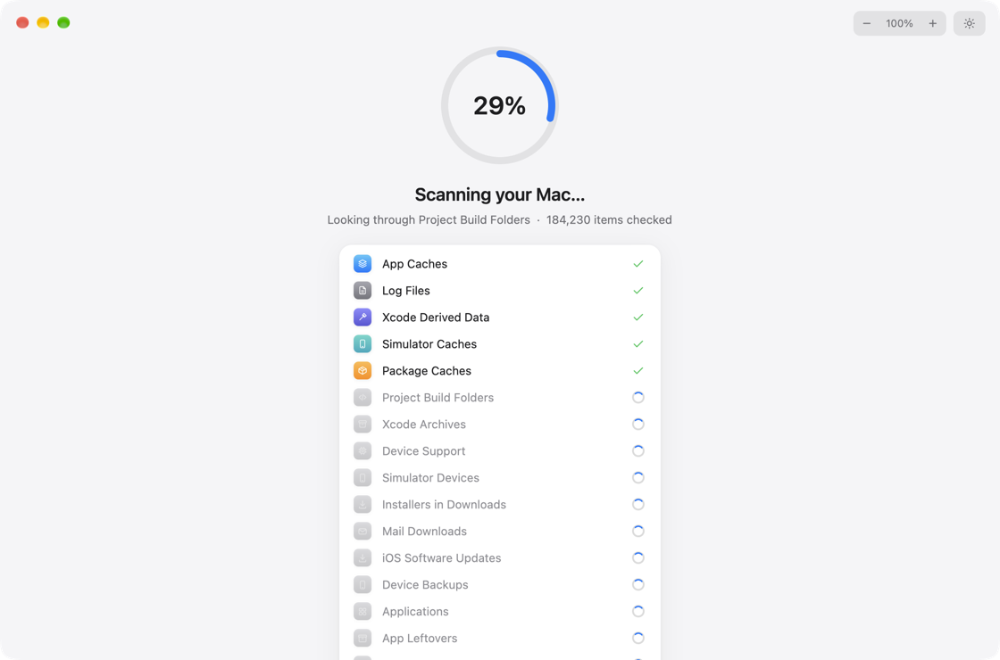

**Open any folder.** See what is inside and tick single items.

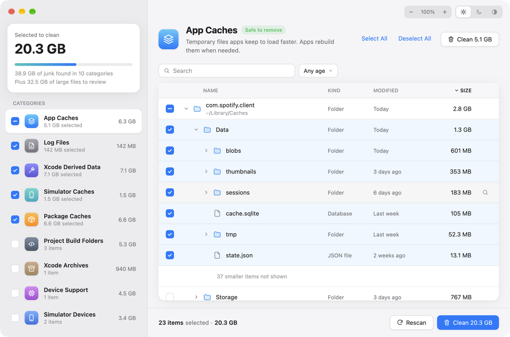

**Large Files & Folders.** Your own big files; never pre-selected.

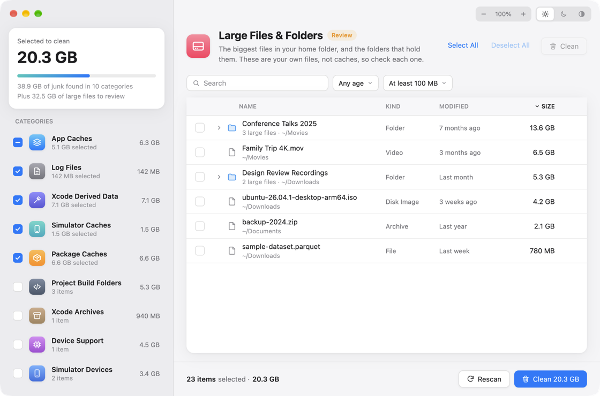

**App Leftovers.** Files left behind by apps you deleted. Anything macOS won't let the app move is marked **Protected by macOS** and left unticked.

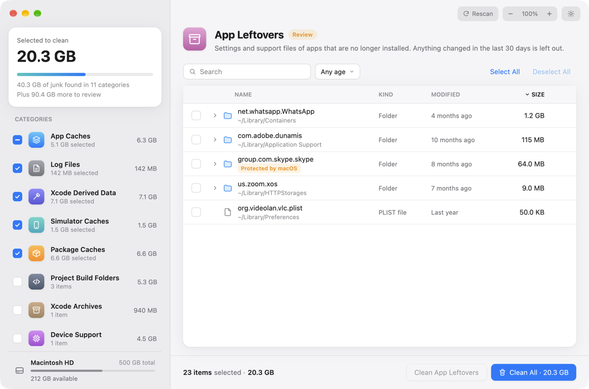

**Search and filters.** Type to narrow the list, or filter by age.

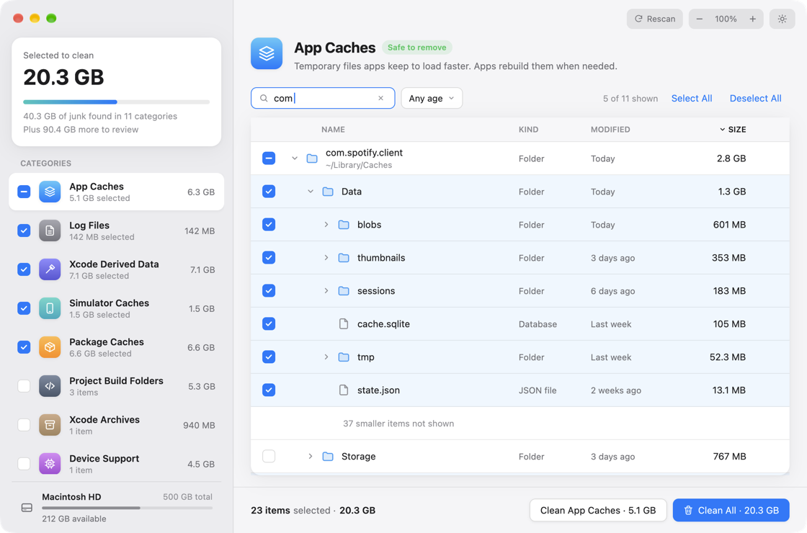

**Right-click a row.** Finder, Quick Look, Copy Path and Always Ignore.

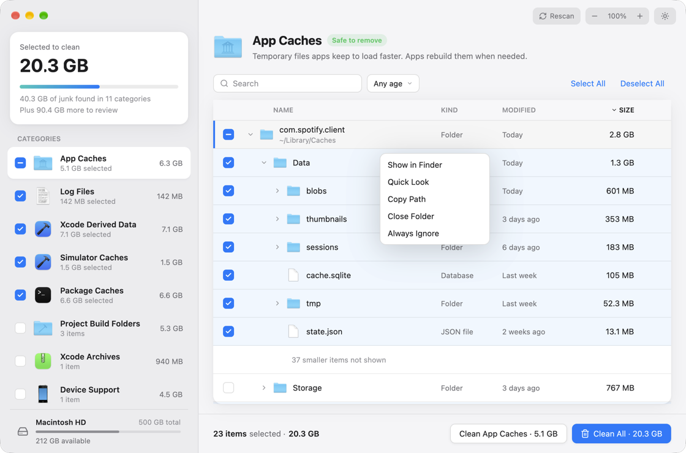

**Confirm.** Every path is listed before anything moves to the Trash.

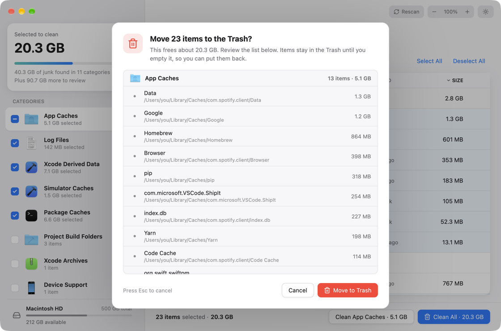

**Result.** Space recovered, and anything that could not be moved.

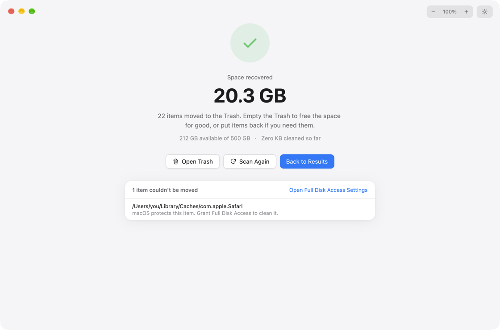

Every picture is the same window at 100% zoom. The whole interface can also be scaled from 85% to 150%.

## Working with the results

- **Search and filters.** Type to search the open category (name, location or kind), or press ⌘F. The age menu keeps only items not modified for 30 days, 6 months or a year. In Large Files & Folders, a size menu sets the smallest file listed and scans again. Select All and Deselect All act on what the filter shows.
- **Keyboard.** Any letter starts a search; ↑/↓ move, Space ticks the row, →/← open and close a folder, ⌘1…⌘9 switch category, ⌘A / ⇧⌘A select and deselect, ⌘R scans again, ⌘Y is Quick Look, Return opens the review dialog (it never confirms the move itself), Esc closes or clears. ⌘+ / ⌘− / ⌘0 change the zoom, ⌘W closes the window, ⌘M minimizes it and ⌘Q quits.
- **Columns.** Name, Kind, Modified and Size; click a heading to sort. The Kind column is dropped when the window is too narrow for it.
- **Right-click a row** for Show in Finder, Quick Look, Copy Path, Open Folder and Always Ignore. Ignored items stay out of every later scan until you press Show Again at the bottom of the sidebar.
- **Honest totals.** The sidebar counts junk only; large files are your own files and are listed separately until you select them.
- A scan can be cancelled, and shows how many items it has checked.
- **After a clean,** the result screen shows the space recovered and lists anything that could not be moved, with the reason. If macOS protected an item, a button opens the Full Disk Access settings. When you clean a single category, anything that could not be moved stays in its list marked **Couldn't be moved** and is unticked, so it doesn't look like it is still waiting to go.
- **The welcome screen** shows free disk space, when the last scan ran and how much has been cleaned so far.
- **Storage** for your Mac (name, used-space bar and space available) sits at the bottom of the results sidebar. It is read again every 3 seconds, so emptying the Trash or a big download shows up without a rescan. "Available" matches Finder and System Settings: it includes space macOS frees on demand.

## Updates

From version 1.3.0, Mac Cleaner keeps itself up to date. (Versions 1.2.0 and earlier have to be updated by hand, once.)

- A few seconds after launch, and once a day while it stays open, the app asks GitHub for the latest release. When there is a newer one, an **Update Available** button appears in the top-right corner. Nothing is downloaded until you click it.
- The button opens a dialog with the release notes. **Update Now** downloads the DMG with a progress bar, checks its signature, quits, swaps the app in Applications and opens the new version. **Later** closes the dialog; the button stays.
- **Check for Updates…** in the Mac Cleaner menu, or the button in About Mac Cleaner, checks right away. About Mac Cleaner also has the **Check for updates automatically** switch.
- If anything goes wrong (no connection, a bad signature, an app folder it can't write to), the dialog says so and the installed app is left as it was.

To check a download by hand: `minisign -Vm Mac-Cleaner-<version>-arm64.dmg -P RWQY3Ut882lI3/1xnXKTU/0Z74Iv8BV6izJOrYJ9F2irRv6MCb0xT5k4`. How releases are signed is in [Development](development.md#releasing).

## Menus

| Menu | Items |
|---|---|
| Mac Cleaner | About Mac Cleaner, Check for Updates…, Quit |
| File | Scan Again, Review & Clean…, Quick Look, Close Window |
| Edit | Select All, Deselect All, Find |
| View | Light, Dark, Match System, Zoom In, Zoom Out, Actual Size |
| Window | Minimize |

## Appearance and settings

**Theme.** Click the theme button in the top-right corner (it shows a sun, moon or half circle for the current choice) and pick Light, Dark or Match System, or use the View menu. Match System follows the macOS setting.

**Zoom.** For anyone who finds the interface too small (or too large):

- ⌘+ zooms in, ⌘− zooms out, ⌘0 returns to 100%. The same commands are in the View menu.
- The − 100% + control in the top-right corner does the same with the mouse; clicking the percentage returns to 100%.
- Levels are 85%, 100%, 115%, 130% and 150%.
- Text, icons, spacing, columns, dialogs and popup menus scale together, so the layout looks the same at every level.
- The window grows and shrinks with the zoom and never gets larger than the screen. The smallest size it can be dragged to scales too.
- On a small screen at a high zoom, the welcome, scanning and result screens scroll instead of being cut off.
- The app also follows macOS's own display scaling (System Settings → Displays), like every other app.

**Saved between launches.** The theme, the zoom level, the Large Files size limit, the ignore list, the last scan time, the running total of cleaned space and whether to check for updates automatically are saved as plain text in `~/Library/Application Support/Mac Cleaner/settings.txt`. That folder is never scanned or cleaned.
